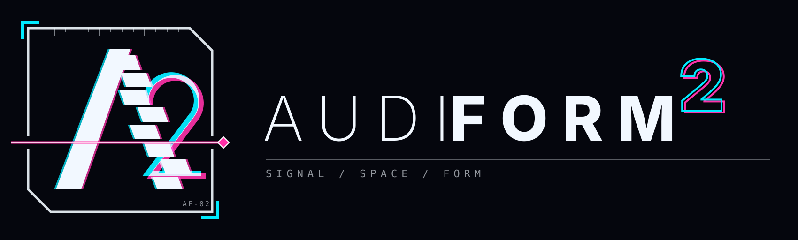

# AudiForm 2



(Working name until 2026-11-19: Audiform27. The crates, the `.af27`
and `.af27theme` extensions and the settings folder keep that name so
nothing saved is lost.)

A fast, themeable audio editor written entirely in Rust. It's the sequel to
[Audiform](https://github.com/nwh212/Audiform), rebuilt from scratch.

Audiform27 covers the full professional editing workflow: a destructive
**Waveform editor** with a spectral display, a non-destructive **Multitrack
editor** with a mixer, a dockable panel layout, effects, analysis and local
AI stem separation. The look, names and code are its own.

## Build and run

```bash
cargo run --release -p audiform27
```

Windows is the main target. Linux needs the ALSA headers (`libasound2-dev`).
You can pass files or sessions on the command line, or drop them on the window.

## What works today

- **Waveform editor**: every channel stacked (mono through 7.1), gradient
  waveforms with glow, an overview bar, a ruler, markers, time selection,
  zoom at the pointer, and a stacked per-channel **spectral display**.
  Cut, copy, paste, crop, delete, insert silence, generate tone, noise or
  silence. Undo and redo with history.
- **Multitrack editor**: audio, **bus** and **MIDI** tracks. You can move
  clips in time and between tracks (with snapping), trim either end, use
  the razor to split, split at the playhead, drag files in from the Files
  panel, use clip gain and fades, mute, solo, arm, volume and pan, add
  markers, select time, and undo everything. Outputs go to the master or a
  bus, and **pre- or post-fader sends** feed buses. There's a **Mixer**, a
  tempo with a **metronome**, and mixdown, stem and bounce export to WAV
  or FLAC (any common rate, dither, loudness targets).
- **Effect chains**: 16 slots on every track and bus and on the master.
  Settings, bypass and order change live while playing, without
  restarting tails. The **Inspector** panel shows the selected track's
  output, sends, chain, 3D position and instrument.
- **3D Space sessions**: place each track in a room (5.1 to 7.1.4) instead
  of panning it. Listen binaurally on headphones or folded to stereo, and
  export a multichannel WAV of the speaker bed.
- **MIDI**: MIDI clips in beats, a **Piano Roll** (16 channel colours,
  draw, erase, move, resize, velocity and pan lanes, grid snap, Humanize),
  and a built-in synth (PolyBLEP oscillators, detune, ADSR, resonant filter).
- **Effects**: 23 built in (Amplify, Normalize, Match Loudness, fades,
  Invert, Reverse, Silence, DC Offset, Parametric EQ, High- and Low-Pass,
  Notch, Hum Remover, Compressor, look-ahead Limiter, Noise Gate,
  De-Esser, spectral Noise Reduction, Echo, Reverb, Stereo Width, Speed),
  plus the **Audiform effects** carried over with their original tuning:
  Amp Model (neural `.nam` captures), Tube Preamp, Opto Leveler, Vox
  Strip, Reverb (Room, Hall, Plate, Spring, Tape), Convolution Reverb,
  Modulation (Chorus, Flanger, Phaser, Double Track), Center Channel
  Extractor, Channel Mixer, Stereo Width and Phase Curve.
- **Analysis**: Level Statistics (integrated LUFS per BS.1770, true peak,
  sample peak, RMS, DC offset, delivery target checks), the **Phase
  Wheel** (Audiform's, calibrated as it was), a Spectrum analyzer, and
  Levels meters with peak hold.
- **AI Stems**: local stem separation through the separation engine. It
  reuses the engine and models an Audiform install already downloaded, so
  nothing is fetched twice. Downloads are on demand and SHA-256 checked.
- **Recording**: record into a new file, or onto an armed track at the playhead.
- **Docking**: every panel can be dragged, tabbed, split, floated or closed
  (Window menu to reopen; Window > Reset Layout). The layout is saved
  between runs.
- **Themes**: every colour, gradient, spectrogram palette, corner radius
  and glow comes from a theme (see below).

## Formats

| Read | Notes |
| --- | --- |
| WAV, BWF, RF64, AIFF/AIFC, FLAC, MP3, MP2, Ogg Vorbis, Opus, AAC/M4A/MP4, CAF, MKV/WebM audio | Every channel is kept |
| DTS in WAV (DTS music CDs) and raw `.dts` | Decoded to 5.1 / 6.1 by `af27-dts` |
| `.mogg` | Unencrypted multitrack Ogg; encrypted files are refused |
| Multichannel | Stays multichannel; playback folds to stereo (-3 dB centre and surrounds, LFE out) |

| Write | |
| --- | --- |
| WAV | 16-bit and 24-bit integer (dithered), 32-bit float |

| Sessions | |
| --- | --- |
| `.audfrm` / `.altaudio` | **The session format.** Read and written losslessly: everything Audiform27 does not use (automation, clip stretch, slot routing and presets, libraries, view, metadata, newer fields) is saved back untouched, so sessions go back and forth between Audiform and Audiform27. All 75 of the lead's real sessions load and save back byte-identical. |
| `.af27` | A plain dump of Audiform27's own model |
| `.sesx` | Imports tracks, clips, source in/out, clip gain and mute, fades, track volume, pan, mute, solo, markers and file paths (absolute or relative). Effects and automation are reported as skipped |

## Themes

Themes are JSON files with the `.af27theme` extension. Put them in
`%APPDATA%\Audiform27\themes\` (Windows), `~/.local/share/Audiform27/themes/`
(Linux) or `~/Library/Application Support/Audiform27/themes/` (macOS), then
pick one from **View > Theme**. **Save Current Theme As** writes the active
theme out as a starting point, and any field you leave out falls back to the
default. See `docs/themes/Ice Cave.af27theme`.

Built-in themes: **Neon Abyss** (the default), **Synth Sunset** and
**Phosphor**.

## Keyboard

Space play/stop · Shift+Space record · Ctrl+Z / Ctrl+Y undo/redo · Ctrl+O
open · Ctrl+S save · Ctrl+N new file · Ctrl+A select all · Ctrl+X/C/V ·
Ctrl+T crop · Delete · Ctrl+K split at playhead · Ctrl+L loop · Home / End ·
M add marker · 9 Waveform · 0 Multitrack · V Move · R Razor · T Time
Selection · = / - zoom · Esc clear selection.

## Workspace

| Crate | |
| --- | --- |
| `af27-core` | Audio buffers, the session model, undo history |
| `af27-io` | Decoding (symphonia + DTS + MOGG) and WAV writing |
| `af27-dsp` | Effects, filters, loudness, FFT, spectrogram, resampling, noise reduction |
| `af27-engine` | Real-time playback and recording (cpal; lock-free, no allocation on the audio thread) |
| `af27-interop` | `.sesx` and `.audfrm` import |
| `af27-separation` | AI stem separation client |
| `af27-space` | 3D Space: speaker layouts, room panning, binaural listening |
| `af27-fx` | The Audiform effects |
| `af27-dts` | DTS Coherent Acoustics core decoder |
| `app` | The egui application |

## Performance

The engine never allocates or locks on the audio thread. Each block,
every track's own work (its clips or notes, effect chain and fader) is
spread over a pool of worker threads that the audio thread drives with
atomics alone, and buses that do not feed each other run side by side
too. A one-core device simply runs everything on the audio thread.

Like-for-like with Audiform: the same dense session (48 stereo tracks,
crossfading clips, EQ and compressor on every track, a reverb on every
third, two reverb buses), on the same PC, 2026-11-19, with the thread
count limited to stand in for smaller devices:

| Threads | Audiform | AudiForm 2 |
| --- | --- | --- |
| 1 | 6.6x real time | 19.6x |
| 2 | 12.5x | 37.1x |
| 4 | 20.5x | 63.3x |
| 20 | 32.6x | 78.0x |

Run them with `AUDIFORM_THREADS=n cargo test --release --lib bench_dense -- --ignored --nocapture`
(Audiform) and `AF2_THREADS=n cargo test --release -p af27-engine --test bench_dense -- --ignored --nocapture`
(AudiForm 2).

The UI draws with wgpu (DirectX 12, Vulkan or Metal) and falls back to
OpenGL by itself where wgpu cannot start. View > Visual Effects picks
Full, Lite or Auto; Auto drops the moving backdrop, scan lines and heavy
glow on a device that cannot keep up. The HUD stops animating while the
window is in the background or minimised.

## Licence

AudiForm 2 is free software under the **GNU General Public License,
version 3 or later** (`LICENSE`, full text in `COPYING`).
`crates/af27-dts` is **LGPL-2.1-or-later**, because its decoder is a Rust
port of FFmpeg's DTS decoder.

AudiForm 2 is written clean-room: it takes no code from Audiform 1 or from
any project it was forked from, only behaviour. Contributions are accepted
only under the terms in `CONTRIBUTING.md`. See `ATTRIBUTION.md` and
`docs/clean-room.md` for where every part comes from.
